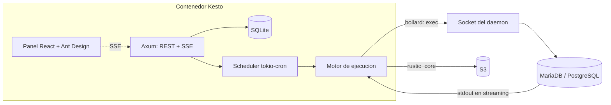

# Kesto

**Orquestador de copias de seguridad de bases de datos y volúmenes a S3, dentro de un contenedor.**

## Qué es

Kesto ("caja" en esperanto) es un contenedor único que:

- ejecuta `mariadb-dump` / `pg_dumpall` **dentro del contenedor de tu base de datos** (vía `exec` por la API del daemon) y transmite la salida **en streaming, sin pasar por disco**;
- guarda el resultado en un **repositorio [rustic](https://github.com/rustic-rs/rustic) sobre S3** (MinIO, RusticFS, AWS);
- aplica **retención** tras cada copia (`keep-daily`, `keep-weekly`, `keep-monthly`);
- lo programa con **cron** y lo muestra en un **panel web** con el progreso en vivo por SSE — las dos últimas piezas, todavía sin construir (ver [Estado](#estado)).

## Estado

Proyecto **en construcción**, pero el código ya ha empezado y los cinco primeros bloques están cerrados. La base está lista —especificación, gitflow, CI y `.justfile`— y sobre ella ya están implementados `bootstrap-core` (arranque, configuración desde el entorno, redacción de credenciales, envoltura JSON única y apagado ordenado), `auth-capability` (sesión en cookie `HttpOnly`, flujo OIDC contra un proveedor externo y puerta sobre toda la superficie de negocio salvo la salud y el propio flujo de entrada), `db-schema` (esquema del §3 aplicado por migraciones embebidas, pool de conexiones, capa de acceso de las cuatro tablas y cifrado en reposo de los tres secretos), `api-endpoints` (el estado de base dentro del estado de la aplicación, los tres recursos del §5 con cinco rutas cada uno y el listado de ejecuciones con filtros y paginación acotada) y `backup-engine` (el motor sin planificador: extracción del volcado sin que un byte pase por el disco, repositorios Rustic sobre S3 con retención, cola con un trabajador por repositorio y SSE con el progreso en vivo), con **405 tests en verde**. Lo siguiente son el planificador y el panel. La especificación técnica ([docs/DEFINITION.md](docs/DEFINITION.md)) manda sobre todo lo demás.

| Pieza | Estado |
|---|---|
| Arranque y API | Cerrado: configuración desde el entorno, envoltura JSON única, salud, `404`/`405` y apagado ordenado (25 tests) |
| Autenticación | Cerrado: sesión firmada con `KESTO_SECRET` en cookie `HttpOnly`, flujo OIDC contra un proveedor externo y todo `/api/v1/*` bajo puerta salvo la salud y el flujo de entrada (93 tests acumulados) |
| Base de datos | Cerrado: esquema del §3 por migraciones embebidas, pool de conexiones, capa de acceso de las cuatro tablas y cifrado en reposo de los tres secretos |
| Superficie del §5 | Cerrado: los diez endpoints del §5 —los tres recursos con cinco rutas cada uno, el listado de ejecuciones, el disparo manual `POST /jobs/:id/run`, el explorador `GET /snapshots` y el stream `GET /events`— (**214 tests acumulados**) |
| Motor de copias | Cerrado: extracción por `exec` con la salida en streaming sin pasar por disco, repositorios Rustic sobre S3 con retención, un trabajador secuencial por repositorio, hub de eventos con SSE y las tres rutas nuevas del §5 (`POST /jobs/:id/run`, `GET /snapshots`, `GET /events`) (**405 tests acumulados** —401 en el binario, 20 de ellos `ignored` por exigir un motor de contenedores, más 4 de integración—) |
| CI ([`.github/workflows/ci.yml`](.github/workflows/ci.yml)) | Verde: `cargo fmt --check`, `cargo clippy -- -D warnings` y `cargo test --locked` |
| Imagen | Pendiente de `Dockerfile`; el job del pipeline se salta solo hasta que exista |
| Crate | `publish = false` a propósito, para no dejar un placeholder permanente en crates.io |
| Panel | `ui/` todavía no existe; el job de frontend del CI se salta solo |

## Arquitectura



| Capa | Tecnología |
|---|---|
| API | Rust + Axum (`src/`) |
| Estado | SQLite con SQLx (WAL, migraciones embebidas) |
| Docker | `bollard` sobre el socket del daemon |
| Repositorios | `rustic_core` + `rustic_backend` hacia S3 |
| Planificador y motor | `tokio-cron-scheduler` para el cron, que todavía no existe; el trabajador secuencial por repositorio está construido y vive en el motor (`src/engine/`), porque Rustic toma un candado exclusivo del repositorio |
| Panel | React + TypeScript + Ant Design (`ui/`), progreso por SSE |

## Requisitos

- **Rust 1.85+** (`edition = "2024"`; desarrollado con 1.97).
- **Podman** en desarrollo y Docker en producción: el motor habla con la API del daemon a través del socket UNIX.
- **Node 24 + pnpm 12** solo si vas a tocar el panel.

## Instalación

La imagen multi-arquitectura (amd64 + arm64) se publica en `ghcr.io/atareao/kesto` en cuanto exista un `Dockerfile`:

```bash
docker pull ghcr.io/atareao/kesto:latest
```

El despliegue de referencia —socket del daemon, directorios del host a respaldar y volumen para la SQLite— está en [docs/DEFINITION.md](docs/DEFINITION.md) §8.

## Desarrollo

Todo pasa por el `.justfile`:

```bash
just --list     # todas las recetas disponibles
just check      # los tres checks del CI, en su orden exacto
just dev        # backend en local
just ui-dev     # panel con recarga en caliente (cuando exista ui/)
```

`just dev` **necesita `KESTO_MASTER_KEY` en el entorno** o el proceso no arranca, y **necesita su propio `DATABASE_URL`**: el valor por defecto (`sqlite:///app/data/kesto.db`) es el del volumen del `compose` del §8, así que en una máquina sin `/app/data` el arranque falla nombrando la ruta —Kesto no crea el directorio a propósito—; exporta uno tuyo (`export DATABASE_URL=sqlite:///tmp/kesto/kesto.db`, con el directorio ya creado) y las migraciones embebidas se aplican solas al abrir. Sin variables `OIDC_*` arranca en modo desarrollo: **sin capa de autenticación**, con todo `/api/v1/*` abierto y `/api/v1/auth/*` contestando `404`; con las tres `OIDC_*` presentes exige además `KESTO_SECRET` y pone la puerta sobre toda la superficie de negocio. Usa `RUST_LOG=debug` para ver el detalle.

Las recetas cubren además el ciclo gitflow (`gf-*`), los planes y las features (`plan-*`, `feature-new`), la imagen local (`build`, `run`) y OpenSpec (`check-spec`, `spec-*`).

## Pipeline

**Un merge a `main` es una release**, sin pasos manuales: [`release-prepare.yml`](.github/workflows/release-prepare.yml) deduce el bump de los conventional commits, sube la versión con vampus, genera el CHANGELOG con git-cliff y etiqueta `vX.Y.Z`. El tag dispara [`release.yml`](.github/workflows/release.yml), que publica la imagen multi-arquitectura en GHCR y el crate en crates.io. Detalles en [GIT_FLOW.md](GIT_FLOW.md).

## Estructura

```text
src/     backend Rust (Axum)
  api/       los recursos del §5, la salud, el flujo de entrada, la sesión y las rutas del motor
  auth/      el flujo OIDC, la sesión y el gate (módulo propio, no del §7)
  db/        pool, migraciones embebidas, cifrado en reposo y entidades del §3
  docker/    el transporte de la API de Docker: exec y salida en streaming
  engine/    el motor: extracción, cola por repositorio, trabajador y hub de eventos
  rustic/    repositorios Rustic sobre S3, puente de lectura, progreso y retención
  config.rs  configuración desde el entorno
  secret.rs  redacción de credenciales
  error.rs   errores tipados + IntoResponse
  state.rs   estado compartido
  # solo scheduler llega con el change siguiente (el planificador)
migrations/ esquema del §3 e índices (0001_init.sql, 0002_indexes.sql)
ui/      panel React + TypeScript + Ant Design (pendiente)
docs/    SRS y un documento por feature (FEATURE-NNN-<slug>.md)
plans/   planes de implementación (PLAN-NNN.md)
```

## Documentación

- [docs/DEFINITION.md](docs/DEFINITION.md) — SRS: esquema SQLite, endpoints, flujos y despliegue
- [AGENTS.md](AGENTS.md) — instrucciones para agentes: layout, podman-first y las trampas del SRS
- [GIT_FLOW.md](GIT_FLOW.md) — ramas, commits convencionales y releases

## Licencia

MIT — ver [LICENSE](LICENSE). También declarada en `Cargo.toml` (`license = "MIT"`), que es lo que exige crates.io para publicar.
